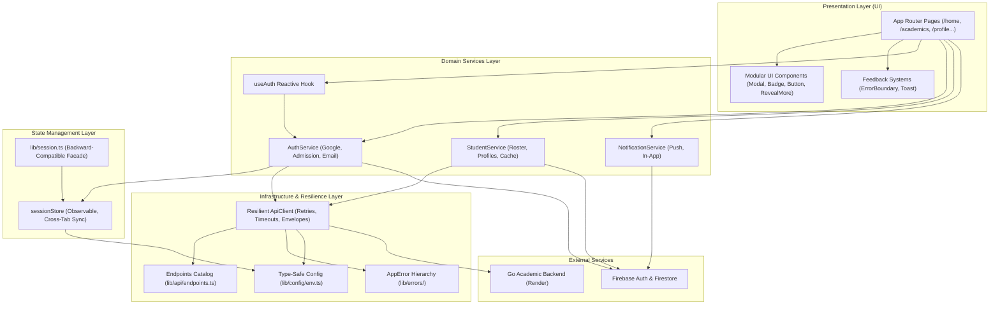

# NexaCampus Architecture & Systems Specification

## 1. System Overview

**NexaCampus School Webapp** is an institutional academic portal built on Next.js 14 (App Router), TypeScript, Tailwind CSS, Firebase Authentication & Firestore, and a distributed Go backend deployed on Render (`https://backend-school-go.onrender.com`).

The application adheres to a clean, layered architecture with strict separation of concerns, defensive error boundaries, reactive state management, and unified design token adherence (Executive Midnight Obsidian palette).

---

## 2. Layered Architecture



---

## 3. Directory & Module Organization

```
school-webapp/
├── app/                          # Next.js App Router (one page per route)
│   ├── api/v1/[...slug]/         # Cached Go-backend proxy (GET cache + mutation passthrough)
│   ├── layout.tsx                # Root layout: fonts, metadata, providers, ErrorBoundary
│   ├── page.tsx                  # Executive campus homepage + 16-module directory
│   ├── home/ academics/ …        # Portal feature screens (one directory per module)
│   └── globals.css               # Design tokens & global styles
├── components/
│   ├── common/                   # UI primitives: Modal, Badge, Button, RevealMore (+ index barrel)
│   ├── directory/                # Campus directory: ExploreCampusesGrid, SchoolShowcaseCard,
│   │                             #   DirectoryFilterDrawer, SharePortalModal
│   ├── feedback/                 # ErrorBoundary and other resilience surfaces
│   ├── public/                   # Public chrome: PublicHeader, SchoolNavDrawer, hero carousel,
│   │                             #   marquee, faculty & transit directories
│   ├── PortalShell.tsx           # Institutional portal chrome (desktop nav, mobile tabs)
│   └── QueryProvider.tsx         # TanStack Query provider, BootSplash, Toasts, PWA
├── hooks/                        # Feature-scoped React Query hooks (useAttendance, useAuth, …)
├── lib/
│   ├── api/                      # Scalable API layer — the only place HTTP lives
│   │   ├── client.ts             # Hardened fetch: retries, timeouts, CSRF, 401 refresh
│   │   ├── endpoints.ts          # Single source of truth for every Go backend route
│   │   ├── go-client.ts          # Domain client (72 routes) with offline fallback data
│   │   ├── go-types.ts           # Response contracts for the Go backend
│   │   └── types.ts              # ApiResponse envelope & request options
│   ├── cache/                    # student-cache: TTL student record memoization
│   ├── config/                   # Centralized type-safe environment configuration
│   │   └── env.ts                # firebaseEnv, apiEnv, appEnv (no raw process.env elsewhere)
│   ├── errors/                   # AppError hierarchy + toAppError translation
│   ├── security.ts               # CSRF header helpers, cookie & token hygiene
│   ├── server/                   # Server-only helpers (LRU proxy cache)
│   ├── services/                 # Pure domain services (decoupled from UI)
│   │   ├── auth.service.ts       # Authentication workflows & session setup
│   │   ├── student.service.ts    # Student roster retrieval & updates
│   │   └── notification.service.ts # Push notification dispatch & permissions
│   ├── state/                    # Reactive state management
│   │   └── sessionStore.ts       # Observable session store with cross-tab sync
│   ├── data.ts                   # Offline fallback fixtures for the Go client
│   ├── firebase.ts               # Firebase SDK initialization
│   ├── firebase-notifications.ts # FCM registration & permission plumbing
│   ├── query-client.ts           # React Query client defaults
│   ├── query-keys.ts             # Query key factory + per-resource cache TTLs
│   └── session.ts                # Thin backward-compatible session facade
├── ARCHITECTURE.md               # This document
├── Auth.md  Security.md  DataSecurity.md  ThreatModel.md  SecurityChecklist.md
└── firestore.rules  firebase.json  middleware.ts  next.config.mjs
```

## 3.1 Documentation Set

| Document | Covers |
|---|---|
| `README.md` | Setup, stack, auth flow, page inventory |
| `ARCHITECTURE.md` | Layers, dependency rules, API contract, state management |
| `Auth.md` | Identity, providers, session lifecycle, role-based access |
| `Security.md` | Defensive coding standards and hardening baseline |
| `DataSecurity.md` | Data classification, encryption and retention lifecycle |
| `ThreatModel.md` | Attack surface map and mitigations |
| `SecurityChecklist.md` | Pre-deploy and ongoing operational checks |


### Dependency rules

1. `app/` and `components/` never call `fetch` — they go through `lib/api/`.
2. `lib/api/` never imports from `app/` or `components/`.
3. `lib/services/` holds domain logic; `hooks/` adapts it to React; pages only consume hooks.
4. `process.env` is read exclusively in `lib/config/env.ts`.


---

## 4. Key Architectural Pillars

### 4.1. Separation of Business Logic from UI
- **Zero Firebase imports in UI views**: Pages consume high-level services (`authService`, `studentService`, `notificationService`) or the reactive `useAuth()` hook.
- **Pure domain operations**: Session provisioning, admission normalization, and profile synthesis reside in domain services.

### 4.2. Reactive State Management (`lib/state/sessionStore.ts`)
- Implements an **Observer / Subscriber pattern**:
  - `subscribeSession(listener)` allows components and hooks to re-render immediately upon session transitions.
  - `storage` event listeners provide multi-tab synchronization across browser windows.
  - Decoupled from React internals, usable in vanilla TypeScript, server helpers, or hooks.

### 4.3. Scalable API Architecture (`lib/api/`)
- **Centralized Catalog (`endpoints.ts`)**: every Go backend route is declared once and consumed by
  `go-client.ts` as `API_ENDPOINTS.<GROUP>.<ACTION>`. No endpoint string is hardcoded in business
  logic, so a backend route change is a single-file edit.
- **Hardened HTTP Client (`client.ts`)**:
  - Exponential backoff retries on 5xx and network blips for idempotent requests.
  - Automatic CSRF header injection (`X-CSRF-Token`).
  - Standardized JSON envelope parsing (`ApiResponse<T>`).
  - Strict timeout guards and silent HttpOnly token rotation on `401`.
- **Domain Client (`go-client.ts`)**: exposes the full 72-route surface as typed methods and always
  resolves to a usable payload — live data when the backend answers, offline fixtures otherwise.
- **Proxy Route Handlers (`app/api/v1/[...slug]/route.ts`)**: same-origin proxy with per-resource TTLs
  and prefix invalidation on mutation, so the browser never calls the Go backend cross-origin.


### 4.4. Domain Error System (`lib/errors/AppError.ts`)
- Strongly typed error subclasses:
  - `NetworkError` (status code, endpoint)
  - `AuthenticationError`
  - `AuthorizationError`
  - `ValidationError` (field-level violation mapping)
  - `RateLimitError` (retryAfterMs support)
  - `NotFoundError`
- **React `ErrorBoundary` (`components/feedback/ErrorBoundary.tsx`)**:
  - Mounted once in `app/layout.tsx`, so any render crash anywhere in the portal tree is trapped.
  - Catches render crashes in child trees; can also be mounted locally with a custom `fallback`.
  - Provides a dignified Obsidian Midnight recovery UI with a retry trigger and diagnostic reference.

### 4.5. Centralized Configuration (`lib/config/env.ts`)
- All environment variables are extracted, validated with defaults, and strictly typed.
- Prevents raw `process.env` references scattered across the codebase.

### 4.6. Modular UI Primitives (`components/common/`)
- Reusable, accessible, keyboard-interactive components:
  - `<Modal />`: Accessible dialog with ESC dismissal, backdrop blur, and primary/danger variants.
  - `<Badge />`: Semantic status and count pills.
  - `<Button />`: Standardized button variants with loading indicators.
  - `<RevealMore />`: Phone-only progressive-reveal control (`Showing X of Y` + expand/collapse arrow) driving the micro-module directory and the security matrix.
- Homepage-local constants (`MODULES_DATA`, `SECURITY_AUDIT_CHECKS`, `buildMonthCalendar`) live in `app/page.tsx` beside the grids that consume them; shared interactive controls live here.

### 4.7. Tailwind Token Caveat (opacity modifiers)

Surface tokens are defined as `background-color: var(--color-surface, #faf8ff)` with **no `--tw-bg-opacity`**, so Tailwind cannot apply an opacity modifier to them — `bg-surface/90` silently generates no CSS and the element ships with no background at all (this once made the cookie panel fully transparent). When transparency is needed, spell out a colour Tailwind can decompose, e.g. `bg-[#faf8ff]/90`. After any change involving `/opacity` utilities, confirm the rule exists in the built stylesheet; a missing rule produces no build error.

### 4.8. Public Header Navigation & Campus Directory

- **Header nav is tenant-derived** (`components/public/PublicHeader.tsx`): the same `NAV_ITEMS` array drives the desktop nav and the mobile drawer. Platform root renders `Platform Overview` + `Academics`; a school tenant renders `About School` + `Academics` with module-aware sub-items.
- **The `Explore Campuses` entry is no longer part of the header.** The `/explore` route stays public and unchanged — it is reachable from the landing-page top bar and module grid, the `SchoolNavDrawer` ("Section 4: Explore Campuses"), the hero carousel, the portal footer, and by direct URL.
- **Campus cards (`components/directory/SchoolShowcaseCard.tsx`)** are laid out in two header rows:
  1. crest + board badge + `Estd. <year>` on the left, `Active Tenant` pill on the right;
  2. the institution name on its **own full-width row**, at `text-lg` with `break-words` and **no line clamp**.
  The name is deliberately never truncated: long institution names (e.g. "Lions Calcutta Greater Vidyamandir", "Delhi Public Academy & Senior Secondary") wrap to two lines and stay fully legible instead of collapsing to "Lions…" / "Delhi…". `Estd. <year>` carries `whitespace-nowrap` so the year never wraps away from its label.

### 4.9. Phone-First Navigation Surfaces

Every hamburger opens a **full-screen** surface on phones — no half-height sheet, no narrow side strip.

| Surface | Phone (< `sm`) | `sm` and up |
|---|---|---|
| Landing drawer (`app/page.tsx`) | `w-full max-w-none` | `max-w-sm` right-hand sheet |
| `PublicHeader` drawer (`components/public/PublicHeader.tsx`) | `h-full`, no bottom rounding | `max-h-[85vh]` bottom sheet |
| `SchoolNavDrawer` (`components/public/SchoolNavDrawer.tsx`) | `w-full max-w-none` | `max-w-md`/`max-w-lg` side sheet |
| `PortalShell` services menu (`components/PortalShell.tsx`) | already `fixed inset-0` | n/a (mobile-only) |

- **Stacking contract**: nav drawers render at `z-[60]`; the cookie banner (`components/CookieConsentBanner.tsx`) and the PWA install prompt (`components/PWARegistration.tsx`) sit at `z-40` so they can never float on top of an open menu; toasts stay at `z-50` so notifications remain visible. A drawer rendered inside a stacking context (e.g. the header) cannot out-rank a root-level overlay unless the overlay's `z` is lowered — that is why the banner and the install prompt were dropped to `z-40`.
- **Phone-only type scale**: inside the drawers, labels use the larger phone size and fall back to the compact size from `sm:` up (section headings `text-xs sm:text-[11px]`, item titles `text-sm sm:text-xs`, sub-items `text-sm sm:text-xs`, CTA buttons `text-sm sm:text-xs`). Icon tiles grow to `w-9 h-9 sm:w-8 sm:h-8` and link rows to `p-3 sm:p-2.5`.
- **Tap targets**: every hamburger is at least 40×40 px (`w-11 h-11` on phones, `w-10 h-10` on `sm` and up).
- **Header rows never overflow**: brand blocks are `min-w-0` with `truncate` so the school name yields space instead of pushing the menu button off-screen; the landing header drops the duplicate platform menu button for school tenants (the school drawer button already covers it) and shortens `Enter Portal` to `Portal` on phones.

### 4.10. Canonical Tenant URLs (subdomain model)

A tenant is addressed by its **own subdomain of the deployed webapp**, never by a path:

| Surface | Student | Admin |
|---|---|---|
| Canonical app URL | `https://<slug>.<APP_HOST>` | `https://<slug>.admin.<APP_HOST>` |
| DNS-bound custom domain | `https://<slug>.nexacampus.tech` | `https://<slug>.admin.nexacampus.tech` |
| Last-resort path fallback | `https://<APP_HOST>/school/<slug>` | `https://<APP_HOST>/school/<slug>/admin` |

- `APP_HOST` comes from `NEXT_PUBLIC_CANONICAL_APP_HOST` (default `school-webapp-self.vercel.app`). The single source of truth is `lib/tenantUrls.ts` (`tenantPortalUrls(slug)`), used by the directory cards, the share modal, the admin console, the SchoolMaker studio and the API client.
- `middleware.ts` **redirects** (308) the legacy path form to the canonical subdomain: `/school/greenwood` → `https://greenwood.school-webapp-self.vercel.app/`, `/school/greenwood/admin` → `https://greenwood.admin.school-webapp-self.vercel.app/admin`. On `localhost` the same redirect targets `http://<slug>.localhost:<port>`.
- The host is resolved by the edge guard and by `TenantContext`, so the tenant slug travels in the **host**, not in a query string.
- Because the redirect crosses a host boundary, the session cookie and the tenant-slug cookie are issued for the **shared parent domain** (`SHARED_COOKIE_DOMAIN`, e.g. `.school-webapp-self.vercel.app`) so a signed-in visitor stays signed in on the tenant subdomain.

### 4.11. Authentication Model

- **Signed session cookie.** The portal session itself stays in the browser (Firebase + `localStorage`), but the edge cannot read `localStorage`. `POST /api/auth/session` therefore mints a **signed, HttpOnly** cookie (`school_auth_token`, HMAC-SHA256 over `{sub, role, tenant, iat, exp}`, secret `SESSION_SECRET`) and `middleware.ts` verifies the signature before letting a protected route through. A client-writable flag cookie can be forged; a signed one cannot.
- **Every mint is verified server-side**: a Firebase ID token is checked against the Identity Toolkit (`accounts:lookup`), an admission number against the Go backend roster (`/api/v1/auth/student-login`), and a SchoolMaker creator token against the Go backend (`/api/v1/maker/auth/validate-token`).
- **Roles.** The token carries a role (`student` | `admin` | `creator`). `/admin` and `/admin/cms` are **no longer public** and additionally require an `admin`/`creator` role; the pages are wrapped in `<RequireSession mode="creator">`, which blocks rendering until the session is confirmed (no content flash).
- **Local development.** The `Secure` attribute is only applied over HTTPS — applying it on `http://localhost` made the browser drop the cookie and left the edge guard without a session.
- The middleware public list now contains only genuinely public routes (landing, chooser, sign-in, statutory pages, maker, explore, apply, disclosures, facilities, faculty).

### 4.12. Boot Splash Screen (`/` route)

- **`components/SplashScreen.tsx`** renders a cinematic deep-navy (`#070D18`) cover over the landing route: ambient pulsing radial glow, emblem scale-in with a cyan drop-shadow, gradient wordmark un-blurring upward, and a 1px scan line beneath it. Hold is **2.0s sharp** (1.2s under `prefers-reduced-motion`), then a 0.3s exit — either a fade + zoom (`exitVariant="fade"`, default) or a circular iris (`exitVariant="portal"` via `clip-path: circle(0% at 50% 50%)`). A discreet `Skip` button fades in top-right. `onComplete` fires when the overlay has fully left the DOM; `forceShow` always plays the full choreography for previews.
- **Replay model.** The overlay is part of the SSR markup, so first paint is always the dark cover — the light page can never flash beneath it. A module-level flag in `SplashScreen` resets on every full document load and survives client-side navigation: **every reload replays the splash; in-app navigation back to `/` never does.** Because modules have one lifetime per document load, the flag is readable during first render — in-app return trips mount with the cover already dismissed, with no post-hydration flash.
- **Clean lifecycle.** The cover is an `AnimatePresence` child: the hold timer (or Skip) triggers the exit transition, `onExitComplete` stops rendering the overlay subtree entirely, and the body scroll lock is restored. Framer Motion drives the choreography; `useReducedMotion` collapses it into a static brand frame with a short cross-fade.

---

## 5. Security & Defensive Design
- **Color Consistency**: Strict adherence to the Executive Midnight Obsidian theme (`#12131a`, `#151622`, `#1a1c2b`, `#222538`, `#3b49df`, `#eaedff`).
- **Defensive Fallbacks**: Google auth synthesizes a complete student profile if Firestore roster queries fail or records are missing, ensuring students are never stranded.
- **CSRF & Token Integrity**: All API mutations pass through validated tokens and session storage caches.
