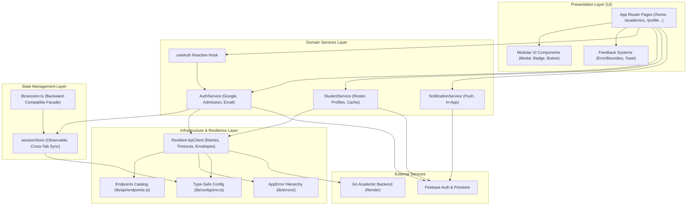

# NexaCampus Architecture & Systems Specification

## 1. System Overview

**NexaCampus School Webapp** is an institutional academic portal built on Next.js 14 (App Router), TypeScript, Tailwind CSS, Firebase Authentication & Firestore, and a distributed Go backend deployed on Render (`https://backend-school-go.onrender.com`).

The application adheres to a clean, layered architecture with strict separation of concerns, defensive error boundaries, reactive state management, and unified design token adherence (Executive Midnight Obsidian palette).

---

## 2. Layered Architecture



---

## 3. Directory & Module Organization

```
school-webapp/
├── app/                      # Next.js App Router (Pages, Layouts, Route Handlers)
│   ├── (auth)/               # Auth routes (admission, email, onboarding, chooser)
│   ├── api/v1/[...slug]/     # API Proxy routes (CORS, CSRF, token forwarding)
│   ├── layout.tsx            # Global root layout with metadata & fonts
│   └── page.tsx              # Executive campus homepage
├── components/               # React UI Components
│   ├── common/               # Atomic design primitives (Modal, Badge, Button)
│   ├── feedback/             # ErrorBoundary, alerts, feedback surfaces
│   ├── home/                 # Executive homepage modules
│   └── PortalShell.tsx       # Institutional student portal shell
├── hooks/                    # Reusable React hooks
│   └── useAuth.ts            # Reactive authentication hook
├── lib/                      # Core business logic, services & infrastructure
│   ├── api/                  # Scalable API client, types, catalog
│   │   ├── client.ts         # Resilient HTTP client with retries & timeouts
│   │   ├── endpoints.ts      # Centralized REST endpoint catalog
│   │   └── types.ts          # Generic ApiResponse & request options
│   ├── config/               # Centralized type-safe environment configurations
│   │   └── env.ts            # firebaseEnv, apiEnv, appEnv
│   ├── errors/               # Domain error hierarchy
│   │   └── AppError.ts       # Network, Auth, Validation, RateLimit errors
│   ├── services/             # Pure domain services (decoupled from UI)
│   │   ├── auth.service.ts   # Authentication workflows & session setup
│   │   ├── student.service.ts# Student roster retrieval & updates
│   │   └── notification.service.ts # Push notification dispatch & permissions
│   ├── state/                # Reactive state management
│   │   └── sessionStore.ts   # Observable session store with tab synchronization
│   ├── firebase.ts           # Firebase SDK initialization
│   ├── session.ts            # Backward-compatible session facade
│   └── apiClient.ts          # Backward-compatible apiClient facade
└── styles/                   # Global style definitions & Tailwind tokens
```

---

## 4. Key Architectural Pillars

### 4.1. Separation of Business Logic from UI
- **Zero Firebase imports in UI views**: Pages consume high-level services (`authService`, `studentService`, `notificationService`) or the reactive `useAuth()` hook.
- **Pure domain operations**: Session provisioning, admission normalization, and profile synthesis reside in domain services.

### 4.2. Reactive State Management (`lib/state/sessionStore.ts`)
- Implements an **Observer / Subscriber pattern**:
  - `subscribeSession(listener)` allows components and hooks to re-render immediately upon session transitions.
  - `storage` event listeners provide multi-tab synchronization across browser windows.
  - Decoupled from React internals, usable in vanilla TypeScript, server helpers, or hooks.

### 4.3. Resilient API Architecture (`lib/api/`)
- **Centralized Catalog (`endpoints.ts`)**: Grouped endpoints for Auth, Students, Academics, Notices, Attendance, and System.
- **Defensive HTTP Client (`client.ts`)**:
  - Exponential backoff retries on 5xx and network blips for idempotent requests.
  - Automatic CSRF header injection (`X-CSRF-Token`).
  - Standardized JSON envelope parsing (`ApiResponse<T>`).
  - Strict timeout guards (default 12,000ms).

### 4.4. Domain Error System (`lib/errors/AppError.ts`)
- Strongly typed error subclasses:
  - `NetworkError` (status code, endpoint)
  - `AuthenticationError`
  - `AuthorizationError`
  - `ValidationError` (field-level violation mapping)
  - `RateLimitError` (retryAfterMs support)
  - `NotFoundError`
- **React `ErrorBoundary` (`components/feedback/ErrorBoundary.tsx`)**:
  - Catches render crashes in child trees.
  - Provides a dignified Obsidian Midnight recovery UI with a retry trigger and diagnostic reference.

### 4.5. Centralized Configuration (`lib/config/env.ts`)
- All environment variables are extracted, validated with defaults, and strictly typed.
- Prevents raw `process.env` references scattered across the codebase.

### 4.6. Modular UI Primitives (`components/common/`)
- Reusable, accessible, keyboard-interactive components:
  - `<Modal />`: Accessible dialog with ESC dismissal, backdrop blur, and primary/danger variants.
  - `<Badge />`: Semantic status and count pills.
  - `<Button />`: Standardized button variants with loading indicators.

---

## 5. Security & Defensive Design
- **Color Consistency**: Strict adherence to the Executive Midnight Obsidian theme (`#12131a`, `#151622`, `#1a1c2b`, `#222538`, `#3b49df`, `#eaedff`).
- **Defensive Fallbacks**: Google auth synthesizes a complete student profile if Firestore roster queries fail or records are missing, ensuring students are never stranded.
- **CSRF & Token Integrity**: All API mutations pass through validated tokens and session storage caches.
